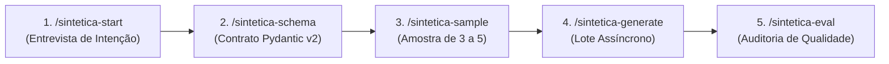

# Sintetica

<div align="center">

**Framework para geração de dados sintéticos orientada por intenção conversacional em harnesses de IA.**

Inspirado nos frameworks do Professor Sandeco (`reversa`, `mira-animator` e `@sandeco/itsfine`).

[](https://www.python.org/)
[](https://nodejs.org/)
[](https://docs.pydantic.dev/)
[](https://mypy-lang.org/)
[](https://docs.astral.sh/ruff/)
[](#qualidade-e-testes)
[](LICENSE)

</div>

---

## 📌 O que é o Sintetica?

O **Sintetica** é um framework desenvolvido para transformar linguagem natural em datasets sintéticos de alta qualidade e totalmente seguros contra vazamentos de dados pessoais (PII).

Integrando-se diretamente aos harnesses de IA mais populares (**Claude Code**, **Antigravity**, **Cursor**, **Gemini CLI** e **Codex**), o Sintetica atua como um time de especialistas autônomos:

1. **Entrevista sem jargões:** Compreende seu objetivo, estrutura, regras de negócio e volume desejado.
2. **Contratos Fortemente Tipados:** Compila modelos dinâmicos **Pydantic v2** isolados para impedir dados malformados.
3. **Amostra com Aprovação Visual:** Gera de 3 a 5 registros iniciais para validação humana prévia.
4. **Motor Assíncrono (`asyncio`):** Gera lotes de até 10.000 registros com controle de concorrência, recuperação de falhas e suporte a `--resume`.
5. **Auditoria Determinística:** Avalia conformidade (≥ 95%), unicidade estrutural e semântica (≥ 90%) e garante **zero vazamento de PII** com mascaramento local.

---

## 🚀 Instalação Rápida

Instale as Agent Skills e o runtime do Sintetica em qualquer projeto através do comando `npx`:

```bash
# Instalação direta pelo GitHub
npx -y github:GeorgeMyller/sintetica install
```

O instalador detecta automaticamente os harnesses de IA presentes no seu projeto (`.claude/`, `.agents/`, `.cursor/`, etc.) e:
- Injeta as 5 **Agent Skills** universais.
- Cria o diretório de governança e políticas locais `.sintetica/`.
- Configura o lançador de alta performance `.sintetica/bin/sintetica`.

---

## 🧭 O Fluxo de Trabalho (Jornada em 5 Passos)

Dentro do seu harness de IA (Claude Code, Antigravity ou Cursor), execute os comandos:

```
/sintetica-start ➔ /sintetica-schema ➔ /sintetica-sample ➔ /sintetica-generate ➔ /sintetica-eval
```



### 1. `/sintetica-start` — Entrevista de Intenção
O agente conduz uma entrevista amigável em 5 perguntas essenciais:
- **Objetivo:** O que os dados simulam?
- **Estrutura:** Quais informações cada linha/objeto deve conter?
- **Regras:** Limites numéricos, categorias permitidas e regras de negócio.
- **Formato:** `JSONL`, `CSV` ou `JSON`.
- **Volume:** Quantos registros gerar (1 a 10.000).

*Disponível nos modos **Guiado** (passo a passo) e **Expresso** (respostas diretas sem pausas).*

### 2. `/sintetica-schema` — Compilação do Contrato de Dados
O agente interpreta a entrevista e grava o rascunho `schema.draft.json`. O compilador determinístico gera:
- `schema.py`: Classe `Record` em **Pydantic v2** com validações de campo.
- `schema.json`: Metadados canônicos e achatamento automático para CSV.
- Tabela Markdown amigável para conferência do usuário.

### 3. `/sintetica-sample` — Amostragem e Sementes
Gera de 3 a 5 registros válidos para revisão visual imediata:
- Validação estrita por Pydantic.
- Mascaramento prévio pelo `pii-guard`.
- O usuário pode responder `aprovar`, `ajustar <pedido>` ou `voltar ao schema`.
- Amostra aprovada vira referência oficial em `seeds/sample.jsonl`.

### 4. `/sintetica-generate` — Geração do Lote Completo
Motor assíncrono com divisão de blocos e resiliência:
- Lotes de teste (≤ 100 registros) executam em primeiro plano a custo US$ 0,00 via agente do harness.
- Lotes de produção (100 a 10.000 registros) rodam como processo desacoplado em segundo plano.
- Atualizações atômicas em `output/records.partial.jsonl` com `fsync`.
- Retomada instantânea em caso de interrupção com flag `--resume`.

### 5. `/sintetica-eval` — Auditoria e Relatório de Qualidade
Avaliador determinístico sem dependência de LLM-juiz:
- **Conformidade de Schema:** (meta ≥ 95%).
- **Unicidade Estrutural:** Hashes SHA-256 distintos (meta ≥ 90%).
- **Unicidade Semântica:** Jaccard com shingles de 3 palavras por busca exata de prefixo (meta ≥ 90%).
- **Vazamentos de PII:** Escaneamento de campos com tolerância zero (meta = 0).
- Emite veredito `APROVADO` ou `REPROVADO` e relatórios `report.md` e `report.json`.

---

## 🛡️ Segurança e Proteção de Privacidade (`pii-guard`)

O Sintetica inclui proteção nativa contra vazamentos de dados pessoais:

| Tipo | Validador | Comportamento |
|------|-----------|---------------|
| **CPF** | Algoritmo Módulo 11 | Detecta formato e dígitos válidos; mascara por valor Faker seguro |
| **CNPJ** | Algoritmo Módulo 11 | Validação matemática dos dígitos verificadores |
| **E-mail** | Sintaxe RFC 5322 | Substitui domínios reais por `example.org`, `example.com`, `example.net` |
| **Cartão** | Algoritmo de Luhn | Detecta números de cartão de crédito e mascara |
| **Telefone** | Padrão E.164 / BR | Reconhece DDDs e números com formatação |
| **IPv4 / IPv6**| Endereços de rede | Mascara IPs públicos para IPs de documentação RFC 5737 |

- **Allowlist Determinística:** Valores falsos gerados pelo Faker são registrados em `.pii_allowlist` com hash SHA-256 para não disparar falsos positivos na auditoria final.

---

## 💻 Referência da Linha de Comando (CLI)

O comando unificado `sintetica` pode ser executado via `.sintetica/bin/sintetica` ou `uv run sintetica`:

```bash
# Iniciar novo dataset
sintetica start <slug> [--mode guiado|expresso]

# Responder e confirmar entrevista
sintetica intent set <slug> --objective "..." --structure "..." --rules "..." --format jsonl --volume 100
sintetica intent confirm <slug>

# Compilar e aprovar contrato
sintetica schema build <slug>
sintetica schema approve <slug>

# Amostragem
sintetica sample run <slug> [--n 3..5]
sintetica sample approve <slug>
sintetica sample adjust <slug> "<instrução>"

# Geração em lote
sintetica generate <slug> [--resume] [--block-size <N>] [--authorize-usd <VALOR>]
sintetica status <slug>

# Avaliação de qualidade avulsa
sintetica eval <slug>
```

---

## 📁 Estrutura de Arquivos de um Dataset

Cada dataset criado é mantido de forma autocontida em `datasets/<slug>/`:

```
datasets/clientes-ecommerce/
├── intent.json                 # Respostas da entrevista de intenção
├── schema.draft.json           # Rascunho declarativo de campos
├── schema.json                 # Especificação canônica do schema
├── schema.py                   # Modelo Record gerado em Pydantic v2
├── schema.state.json           # Histórico e versão do contrato
├── seeds/
│   ├── sample.jsonl            # Amostra aprovada (referência para o lote)
│   └── sample.meta.json        # Metadados e versão da amostra
├── output/
│   ├── dataset.jsonl           # Dataset final validado
│   ├── records.partial.jsonl   # Gravação atômica em fluxo
│   └── run.json                # Status de execução e métricas de custo
├── report.md                   # Relatório visual de qualidade e auditoria PII
└── report.json                 # Métricas e veredito estruturado para CI/CD
```

---

## 🧪 Qualidade e Testes

O projeto segue rigorosos padrões de engenharia de software e conformidade com Clean Architecture:

- **Suíte Python:** 532 testes passando (cobertura global > 90%).
- **Suíte Node.js:** 38 testes nativos passando (`node:test`, cobertura 99,6%).
- **Tipagem Estática:** `mypy --strict` validado em 144 módulos sem apontamentos.
- **Linter & Formatting:** `ruff` validado sem erros.
- **Engenharia Reversa (SDD):** 8 especificações formais com selo 🟢 CONFORME CÓDIGO em `_reversa_sdd/sdd/`.

Para rodar os testes localmente:

```bash
# Testes Python e linters
uv run pytest
uv run mypy src tests
uv run ruff check .

# Testes do instalador Node.js
cd installer && npm test && npm run typecheck
```

---

## 📄 Licença

Distribuído sob a licença MIT. Consulte [LICENSE](LICENSE) para mais informações.
