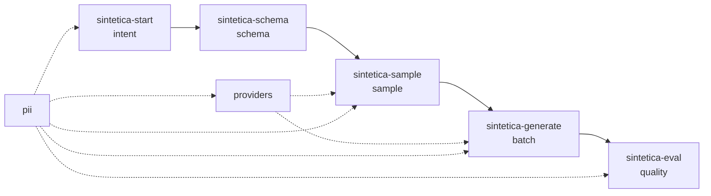

# Arquitetura: sintetica

> Gerado pelo Arquiteto do Reversa em 2026-10-12. Nível: completo.
> Confiança: 🟢 CONFIRMADO (código), 🟡 INFERIDO, 🔴 LACUNA.
> Detalhe: `c4-context.md`, `c4-containers.md`, `c4-components.md`, `erd-complete.md`, `traceability/spec-impact-matrix.md`, `adrs/`.

## 1. Visão geral

🟢 O sintetica é uma ferramenta local de geração de dados sintéticos guiada por intenção. Tem 3 partes:

1. **Skills** (5 arquivos `SKILL.md`): instruem o agente do harness a conduzir o pipeline e chamar o runtime.
2. **Runtime Python** (`src/sintetica/`, pacote `sintetica` 0.1.0): CLI com 9 comandos, organizada em Clean Architecture leve: domínio e portas por módulo (`pii/ports.py`, `providers/ports.py`), adaptadores (`external/`, `harness/`, `allowlist.py`) e serviços que devolvem `CommandResult`.
3. **Instalador Node** (`installer/`, pacote npm `sintetica` 0.1.0): coloca skills, wheel do runtime, lançador e governança no projeto do usuário.

🟢 Não há servidor, banco de dados, fila nem rede própria. O estado vive em arquivos JSON/JSONL por dataset (`datasets/<slug>/`) e em `.sintetica/` (política, preços, instalação).

## 2. Pipeline

## 3. Camadas e módulos

| Camada | Módulos | Papel |
|--------|---------|-------|
| Interface | `cli.py`, skills, `installer/bin` | Comandos e códigos de saída |
| Aplicação | `intent/service.py`, `schema/service.py`, `sample/service.py`, `batch/service.py`, `quality/service.py` | Orquestração por comando; pré-condições; estado |
| Domínio | `pii/domain.py`, `providers/domain.py`, `schema/spec.py`, modelos de estado | Tipos e regras |
| Portas | `pii/ports.py`, `providers/ports.py` | `Detector`, `SubstituteGenerator`, `AllowlistStore`, `LLMProvider` |
| Adaptadores | `pii/allowlist.py`, `pii/substitutes.py`, `providers/external/`, `providers/harness/`, `providers/decorators/` | Faker, arquivos, HTTP |
| Infraestrutura | `fsutil.py`, `batch/lock.py`, `batch/background.py`, `command.py` | Escrita atômica, trava, processo, prefixo de comando |

## 4. Decisões arquiteturais

🟢 15 ADRs retroativos em `adrs/`: skills + runtime local (001), porta `LLMProvider` (002), protocolo `request`/`submit` (003), privacidade por design (004), allowlist por hash (005), contrato declarativo com código gerado (006), CSV plano e decimal exato (007), modos da entrevista (008), amostra como semente (009), lote durável (010), provedor pelo volume e bloco adaptativo (011), background com trava (012), teto de custo (013), avaliação determinística (014), instalador com wheel embutido (015).

## 5. Integrações externas

| Integração | Protocolo | Autenticação | Dados enviados | Falhas |
|------------|-----------|--------------|----------------|--------|
| OpenAI `POST /v1/chat/completions` | HTTPS JSON (`response_format: json_object`) | `Authorization: Bearer $OPENAI_API_KEY` | Pedido mascarado | 429/5xx/timeout: retry; 401/403: `CredentialError`; 404: modelo |
| Anthropic `POST /v1/messages` | HTTPS JSON (`anthropic-version: 2023-06-01`, `max_tokens: 8192`) | `x-api-key: $ANTHROPIC_API_KEY` | Pedido mascarado | Idem; `stop_reason = max_tokens` conta como malformada |
| Gemini `POST /v1beta/models/{model}:generateContent` | HTTPS JSON (`responseMimeType: application/json`) | `x-goog-api-key` (cabeçalho, nunca na URL) | Pedido mascarado | Idem |
| Ollama `POST {OLLAMA_HOST}/api/chat`, `GET /api/tags` | HTTP JSON (`format: json`, `stream: false`) | — | Pedido mascarado (Q30) | Sonda de 2 s; 404 sugere `ollama pull` |
| Agente do harness | Arquivos `requests/<id>.json` e `sintetica submit` | — | Pedido sem mascaramento (o agente já vê a conversa) | Resposta inválida: código 5 |
| PyPI (via `uvx`) | HTTPS | — | Download das dependências do wheel na 1ª execução | Fora do controle do sintetica |
| npm (via `npx`) | HTTPS | — | Download do instalador | Fora do controle do sintetica |

🟢 Todos os provedores devolvem `{"records": [...]}` (APIs) ou 1 objeto por linha (harness).

## 6. Atributos de qualidade

| Atributo | Como o código atende | Evidência |
|----------|---------------------|-----------|
| Privacidade | Mascaramento em 4 pontos; prévia de 2 caracteres; respostas brutas apagadas; logs sem valores | 🟢 `pii/`, `sample/service.py`, `batch/worker.py` |
| Durabilidade | `write_atomic`; anexo com `fsync`; truncamento em erro; diário de desfazer no instalador | 🟢 `fsutil.py`, `batch/output.py`, `installer/src/files.js` |
| Custo | Teto com reserva; autorização explícita; desconto na retomada | 🟢 `providers/decorators/budget.py` |
| Reprodutibilidade | Versão do contrato por SHA-256; código gerado determinístico; relatório determinístico | 🟢 `schema/version.py`, `quality/` |
| Desempenho | Concorrência 8; avaliação de 10.000 registros em ~4 s; lote em fluxo | 🟢 testes `perf` |
| Segurança de código | Nenhum texto do modelo vira código; `spawnSync` sem shell; chaves fora do disco | 🟢 `schema/codegen.py`, `installer/src/runtime.js` |
| Portabilidade | Python ≥ 3.10; Node ≥ 18; ramos POSIX e Windows | 🟡 Windows experimental até haver teste real em CI (Q53) |
| Qualidade | `mypy --strict`, `ruff`, `tsc --checkJs --strict`; 532 + 37 testes | 🟢 `pyproject.toml`, `installer/package.json` |

## 7. Dívidas técnicas

| Dívida | Local | Impacto | Confiança |
|--------|-------|---------|-----------|
| `write_atomic` em 3 cópias | `fsutil.py`, `schema/state.py`, `providers/harness/store.py` | Correção precisa ser feita 3 vezes | 🟢 |
| `CommandResult` em 3 definições e `_Fail` em 3 módulos | `schema/service.py`, `intent/service.py`, `sample/service.py` (reusado por `batch` e `quality`) | Acoplamento de `batch`/`quality` a `sample` só por um tipo | 🟢 |
| Checagem de contrato duplicada | `sample/service.py:85`, `batch/service.py:112` | Mensagens podem divergir | 🟢 |
| Leitura paralela da intenção | `schema/intent.py` (não usa `IntentModel`) | `schema build` não confere `confirmed_at` | 🟢 |
| `batch` importa `quality` dentro de função | `batch/service.py:505-508` | Ciclo de importação contornado, não resolvido | 🟢 |
| Modelos padrão fixos em `defaults.json` | `providers/data/defaults.json` (`gemini-1.5-flash` etc.) | Identificadores podem expirar; `SINTETICA_<BACKEND>_MODEL` contorna | 🟡 |
| Estimativa de custo só pela saída | `providers/pricing.py:69` | Custo real pode passar do estimado; o teto contém | 🟢 |
| Ramo Windows experimental (Q53) | `batch/lock.py`, `batch/background.py`, lançador `.cmd` | Falha só aparece no Windows | 🟡 |
| Wheel versionado como artefato | `installer/runtime/` | Pode ficar desatualizado entre builds; `prepack` regera | 🟡 |

## 8. Restrições

- 🟢 Sem rede no instalador e na avaliação; rede só para provedores externos e downloads de pacotes.
- 🟢 Lote: até 10.000 registros; harness: até 100 por pedido.
- 🟢 Contrato: até 100 campos.
