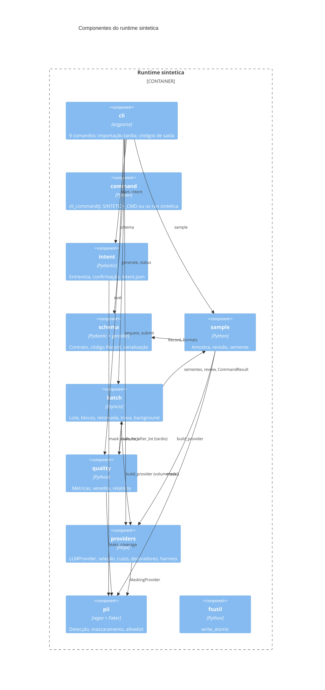
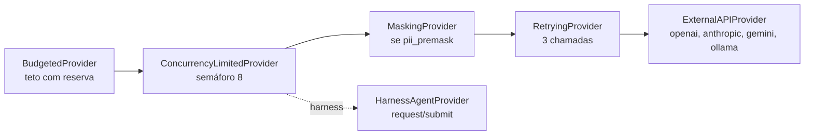
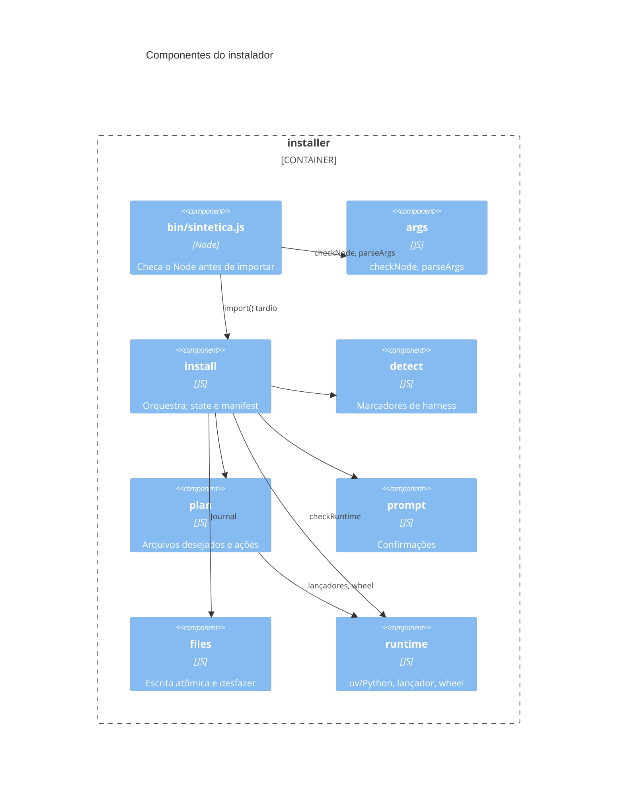

# C4 Nível 3, Componentes: runtime `sintetica` e instalador

> Gerado pelo Arquiteto do Reversa em 2026-10-12. 🟢 extraído do código.

## Runtime Python

| Componente | Entradas | Saídas | Confiança |
|------------|----------|--------|-----------|
| `intent` | Respostas do usuário | `intent.json` | 🟢 |
| `schema` | `intent.json`, `schema.draft.json` | `schema.json`, `schema.py`, `record.schema.json`, `schema.state.json` | 🟢 |
| `sample` | Contrato aprovado, provedor | `sample.state.json`, `seeds/` | 🟢 |
| `batch` | Sementes, contrato, provedor | `output/`, chama `quality` | 🟢 |
| `quality` | `output/dataset.<ext>`, `run.json`, contrato, allowlist | `report.json`, `report.md` | 🟢 |
| `providers` | `GenerationRequest`, política, preços | `GenerationResult`, `requests/` | 🟢 |
| `pii` | Texto, política | Texto mascarado, achados, `.pii_allowlist` | 🟢 |

## Pilha de decoradores do provedor

## Instalador

