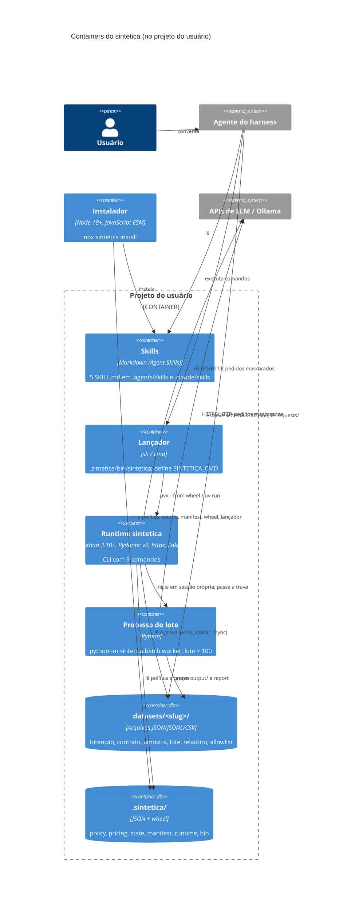

# C4 Nível 2, Containers: sintetica

> Gerado pelo Arquiteto do Reversa em 2026-10-12. 🟢 extraído do código.

| Container | Tecnologia | Responsabilidade | Confiança |
|-----------|-----------|------------------|-----------|
| Skills | Markdown com frontmatter | Instruções ao agente, por etapa | 🟢 |
| Lançador | `sh` (755) e `.cmd` (ASCII, CRLF) | Roda o runtime do wheel; sem wheel, `uv run` | 🟢 |
| Runtime | Python, `argparse`, Pydantic, httpx, Faker | Todos os comandos do pipeline | 🟢 |
| Processo do lote | Python, `asyncio` | Lote acima de 100 registros, com trava | 🟢 |
| `datasets/<slug>/` | Arquivos | Estado de cada dataset | 🟢 |
| `.sintetica/` | Arquivos | Governança e runtime instalado | 🟢 |
| Instalador | Node, só biblioteca padrão | Instalação idempotente com desfazer | 🟢 |
