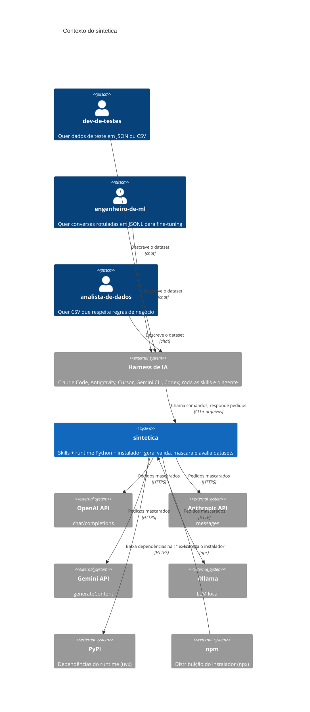

# C4 Nível 1, Contexto: sintetica

> Gerado pelo Arquiteto do Reversa em 2026-10-12. 🟢 extraído do código e do PRD.

| Elemento | Relação com o sintetica | Confiança |
|----------|------------------------|-----------|
| Personas | Interagem só pelo harness; nunca chamam o runtime direto | 🟢 |
| Harness | Lê as skills, roda a CLI, gera registros no protocolo `request`/`submit` | 🟢 |
| APIs de LLM e Ollama | Recebem pedidos mascarados; opcionais | 🟢 |
| PyPI e npm | Só distribuição | 🟢 |
