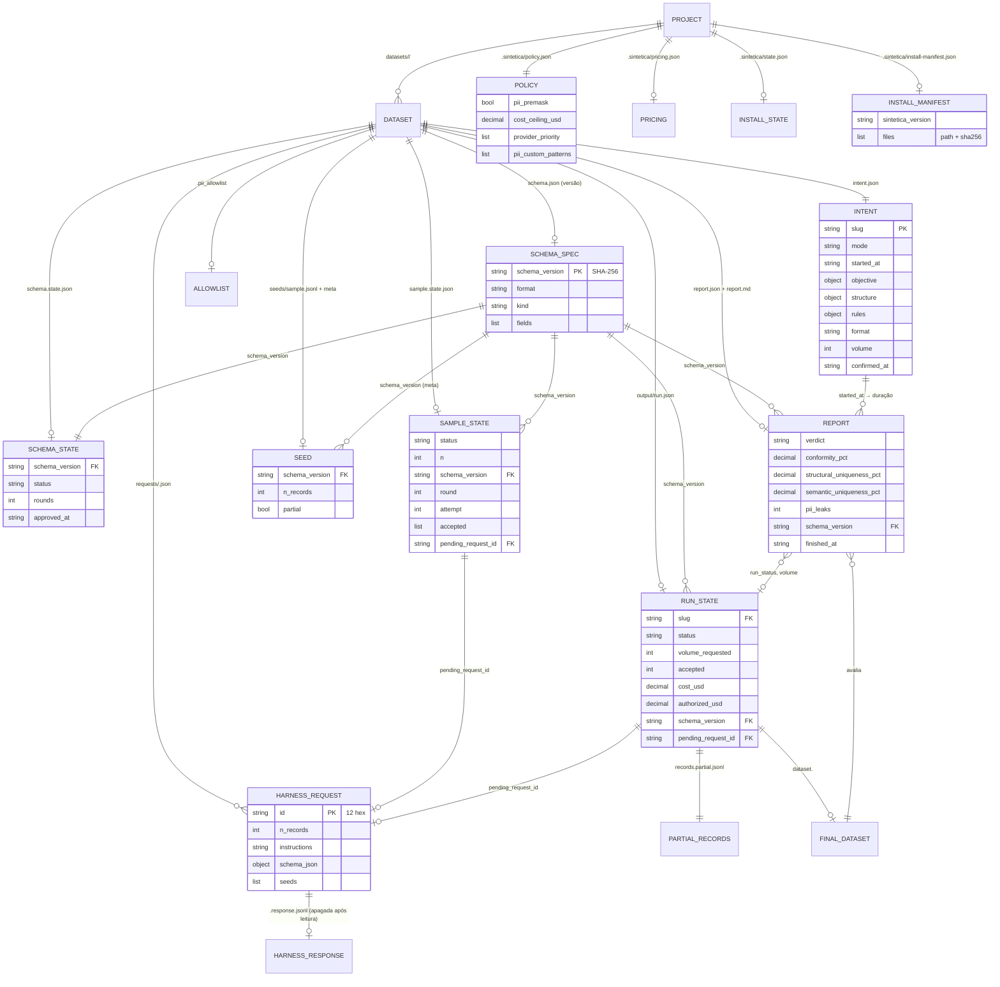

# ERD: sintetica

> Gerado pelo Arquiteto do Reversa em 2026-10-12. 🟢 extraído do código.
> Não há banco de dados. As "entidades" são arquivos por dataset e por projeto; as chaves são o `slug`, a versão do contrato (`schema_version`) e o id do pedido. Campos completos em `data-dictionary.md`.

## Cardinalidades e regras

| Relação | Regra | Confiança |
|---------|-------|-----------|
| Dataset → intenção | 1:1, criada no `start` | 🟢 |
| Contrato → amostra, semente, lote, relatório | A versão amarra tudo; versão nova invalida amostra e bloqueia lote antigo | 🟢 |
| Lote → pedido do harness | 0..1 pendente por vez; 1 pedido por rodada | 🟢 |
| Pedido → resposta | 0..1; a resposta é apagada depois de lida | 🟢 |
| Dataset → lote | 0..1 em andamento (trava) | 🟢 |
| Projeto → allowlist | 1 por dataset, só cresce | 🟢 |
