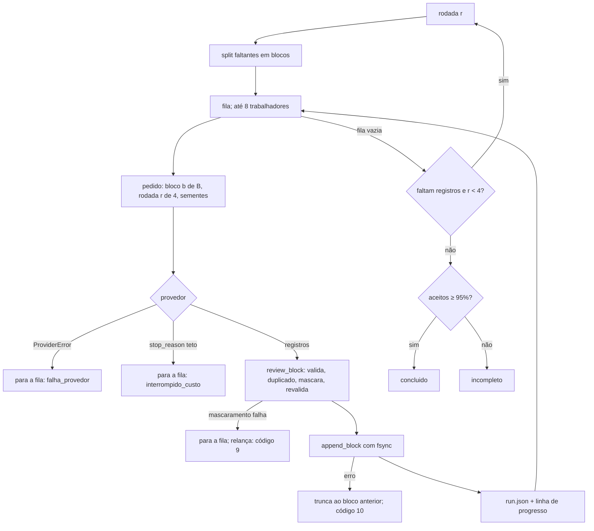
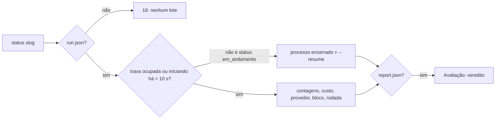

# Fluxograma: módulo `batch`

> 🟢 Extraído de `src/sintetica/batch/service.py`, `engine.py`, `output.py` e `lock.py`.

## `sintetica generate`

```mermaid
flowchart TD
    A[generate slug] --> B[pré-condições: intenção, contrato aprovado,<br/>amostra da mesma versão, volume]
    B -- falha --> EC[2, 11 ou 14]
    B --> L{trava livre?}
    L -- não --> E16[16 + status atual]
    L -- sim --> X{lote existente?}
    X -- aguardando_agente --> EXE
    X -- concluido ou contrato mudou --> E16b[16, sugere --new]
    X -- interrompido sem --resume --> E16c[16, sugere --resume ou --new]
    X -- --resume --> RES[status em_andamento, rodada 0]
    X -- nenhum ou --new --> NEW[tokens médios da amostra<br/>bloco adaptativo]
    NEW --> P[provedor pelo volume total]
    P --> CE{estimativa exige autorização<br/>e sem --authorize-usd?}
    CE -- sim --> E15[15: valor e comando, 0 pedidos]
    CE -- não --> RS[RunState com teto autorizado]
    RS --> V
    RES --> V{volume > 100?}
    V -- sim --> BG[iniciando + processo em sessão própria<br/>herda a trava; volta com o PID]
    V -- não --> EXE[_execute]
    EXE --> LP[load_partial: corta linha incompleta,<br/>reconta, reconstrói índice]
    LP --> PV[provedor com teto = autorizado − gasto]
    PV --> H{harness?}
    H -- sim --> RH[run_harness]
    H -- não --> RA[run_automatic]
    RH -- aguardando_agente --> PEND[mostra pedido e submit]
    RH --> FIN
    RA --> FIN[status final]
    FIN --> CF[convert_final em fluxo]
    CF --> EV[evaluate_after_lot dentro da trava]
    EV --> OUT[resumo + veredito; código 0 ou 12]
```

## Rodada automática



## `sintetica status`


