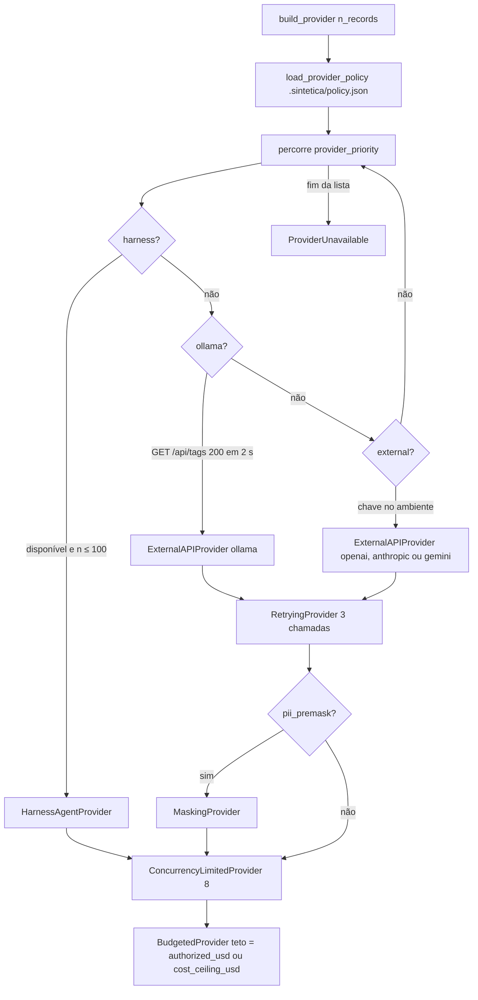
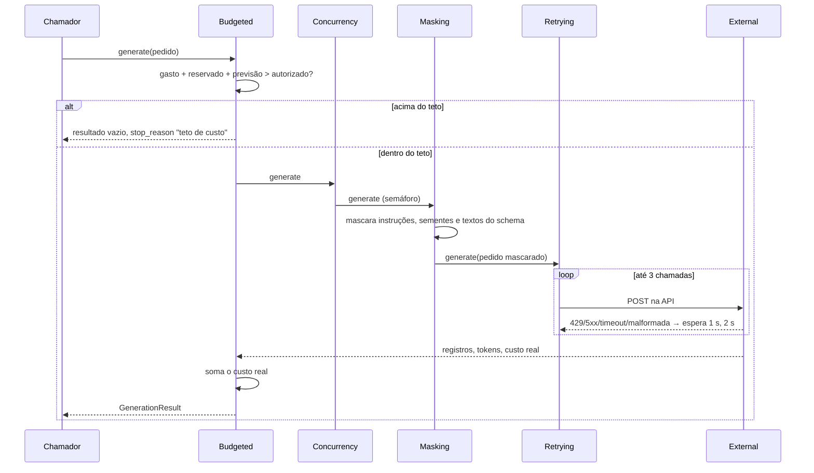
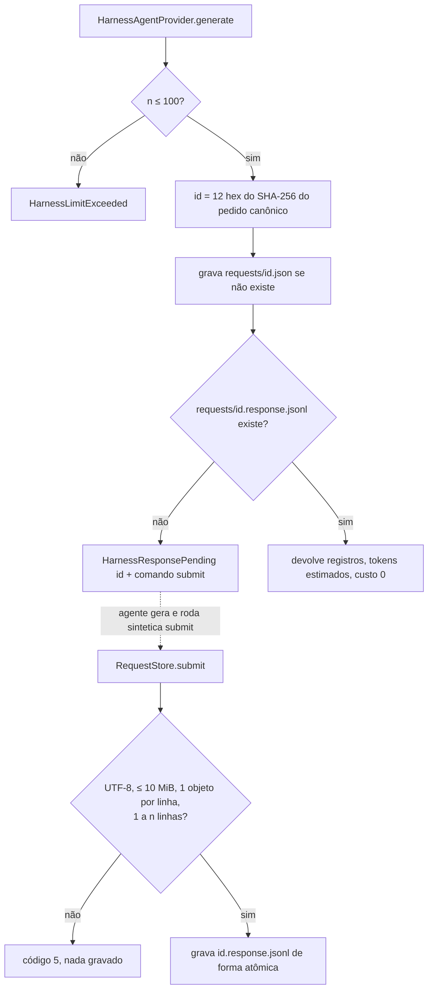

# Fluxograma: módulo `providers`

> 🟢 Extraído de `src/sintetica/providers/factory.py`, `selection.py`, `decorators/*.py` e `harness/*.py`.

## `build_provider` e `select_provider`

## Pedido externo com teto e retry

## Protocolo do harness

