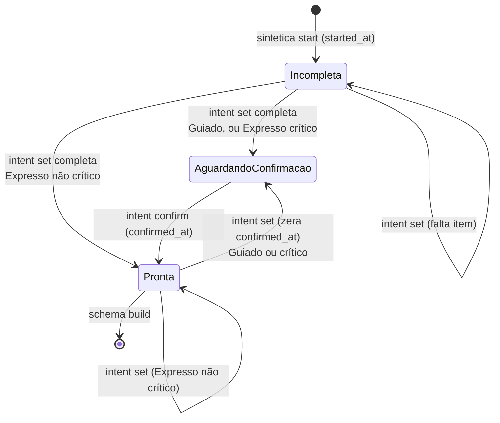
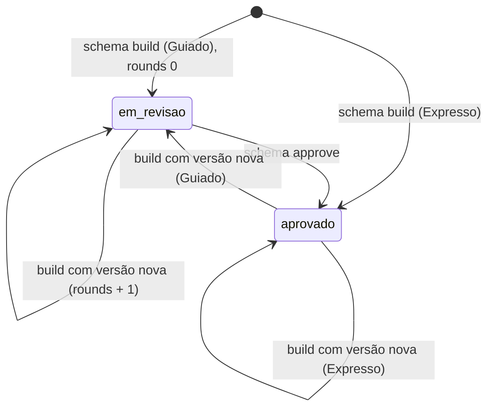
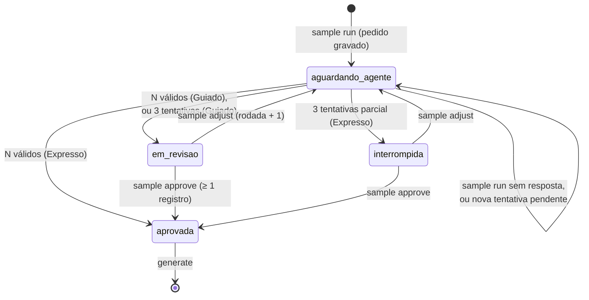
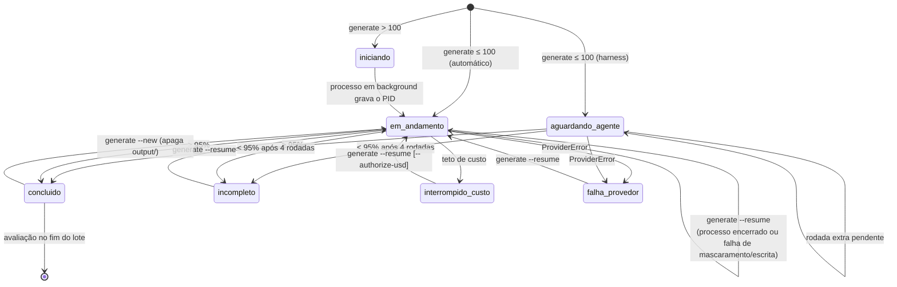
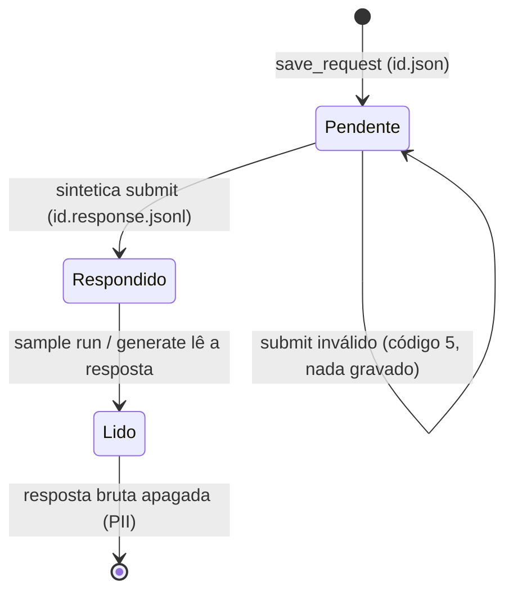
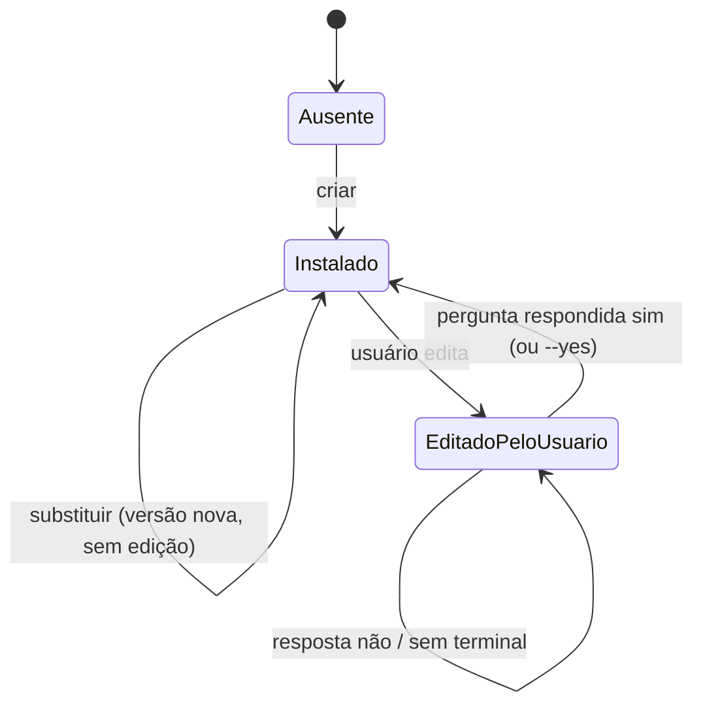

# Máquinas de estado: sintetica

> Gerado pelo Detetive do Reversa em 2026-10-12. 🟢 extraído do código, salvo marcação.

## 1. Intenção (`intent.json`)

🟢 Estado derivado de `Item.status`, `format`, `volume` e `confirmed_at` (`intent/summary.py`).

| Item de texto | Estados | Transição |
|---------------|---------|-----------|
| `objective`, `structure`, `rules` | `pendente` → `definido` (texto mascarado) ou `indefinido` (`--unknown`) | Qualquer resposta nova substitui |

## 2. Contrato (`schema.state.json`)

🟢 Com `rounds ≥ 5` em revisão, a saída sugere reiniciar a entrevista (`schema/state.py:43-45`).

## 3. Amostra (`sample.state.json`)

🟢 Versão nova do contrato descarta o estado e recomeça (`sample/service.py:313-316`). Provedores automáticos passam direto por `aguardando_agente` (sem pedido pendente).

## 4. Lote (`output/run.json`)

🟢 Estados finais: `concluido`, `incompleto`, `interrompido_custo`, `falha_provedor` (`batch/state.py:36-38`). "Processo encerrado" não é status: é `em_andamento` (ou `iniciando` há mais de 10 s) com a trava livre (`batch/service.py:231-243`).

## 5. Pedido do harness (`requests/<id>.*`)

## 6. Veredito da avaliação (`report.json`)

🟢 Não há transição persistida: cada `eval` recalcula. `APROVADO` ↔ `REPROVADO` muda só se o dataset, o contrato ou a allowlist mudarem.

## 7. Arquivo no instalador

🟢 `policy.json` válido nunca sai de "editado/preservado"; inválido vira `.bak` e volta ao padrão.
